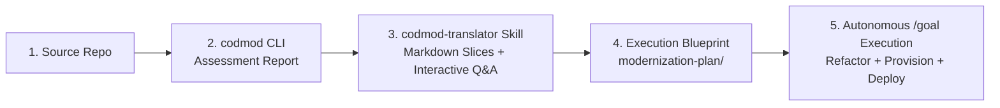

# Agent Skills

A collection of reusable skills for **Antigravity (`agy`)** and compatible AI coding agents.

## Available Skills

| Skill | Description |
| :--- | :--- |
| [`codmod-translator`](./codmod-translator/SKILL.md) | Reviews or generates any Google Cloud Migration Center App Modernization Assessment (`codmod`) report, interactively selects the target modernization strategy and Google Cloud backing services, constructs a 4-phase `/goal` execution plan, and refactors + deploys the workload end-to-end. |

## Repository Structure

```text
skills/
├── LICENSE
├── README.md
└── codmod-translator/
    ├── SKILL.md
    ├── references/
    │   └── gcp-deployment-patterns.md
    └── scripts/
        └── extract_codmod_report.py
```

---

## Installation

### Option 1: Install via `skills` CLI (Directly from GitHub)

```bash
npx skills add frankiejgit/skills
```

### Option 2: Install Globally (Available in All Workspaces)

```bash
# For Antigravity CLI & IDE global config
mkdir -p ~/.gemini/config/skills
cp -R codmod-translator ~/.gemini/config/skills/

# Or directly in the Antigravity CLI skills directory
mkdir -p ~/.gemini/antigravity-cli/skills
cp -R codmod-translator ~/.gemini/antigravity-cli/skills/
```

### Option 3: Install in a Specific Project Workspace

```bash
mkdir -p /path/to/your-project/.agents/skills
cp -R codmod-translator /path/to/your-project/.agents/skills/
```

---

## Usage Guide: `codmod-translator`

The **`codmod-translator`** skill turns any Google Cloud Migration Center Application Modernization Assessment (`codmod`) report into an interactive, end-to-end code refactoring and Google Cloud deployment workflow across any codebase, language, or `codmod` report type.



### Prerequisites

- **Google Cloud Project** with billing enabled and appropriate IAM permissions (`Owner` or permissions to provision target services).
- **[gcloud CLI](https://docs.cloud.google.com/sdk/docs/install)** authenticated (`gcloud auth login`) and configured with your target project and region:
  ```bash
  export PROJECT_ID="$(gcloud config get-value project)"
  export REGION="us-central1"
  gcloud config set project "${PROJECT_ID}"
  gcloud config set run/region "${REGION}"
  ```
- **[Antigravity CLI (`agy`)](https://antigravity.google/docs/cli/overview)**
- **[`codmod` CLI](https://docs.cloud.google.com/migration-center/docs/app-modernization-assessment)** *(required only if generating new assessment reports; not required if you already have a report file)*:
  ```bash
  version=$(curl -s https://codmod-release.storage.googleapis.com/latest)
  curl -O "https://codmod-release.storage.googleapis.com/${version}/linux/amd64/codmod"
  chmod +x codmod
  sudo mv ./codmod /usr/local/bin/codmod
  ```
- **Python 3** (used by [`extract_codmod_report.py`](./codmod-translator/scripts/extract_codmod_report.py) to parse large HTML reports using only the Python standard library).
- **[Google Developer Knowledge MCP](https://developers.google.com/knowledge/mcp)** *(optional, recommended)*: Allows the agent to query live Google Cloud documentation (`search_documents` / `get_documents` / `answer_query`) for your selected target services.

---

### Starter Prompts

Open `agy` inside your target application repository and run one of the following prompts:

#### Option A: Full End-to-End Flow (Generate `codmod` Report + Refactor + Deploy)
Use this when starting from a raw codebase without an existing assessment report:

```markdown
/goal Run a full codmod assessment on this codebase, help me choose the target modernization path, and execute the modernization plan end-to-end to deploy the application and its supporting services on Google Cloud.
```

#### Option B: Pre-Generated Report Flow (Use Existing `.html` Report + Refactor + Deploy)
Use this when you already have a `codmod` report (e.g., `report.html`) in the workspace and want to skip the `codmod` scan time:

```markdown
/goal Review @report.html, help me choose the target modernization path, and execute the modernization plan end-to-end to deploy the application and its supporting services on Google Cloud.
```

#### Option C: Plan-Only Preview (Generate Execution Plan Without Deploying)
Use this when you want to extract the report digest, pick your architecture, and generate the tailored `/goal` execution plan for review before modifying code or provisioning cloud resources:

```markdown
Review @report.html and generate the modernization execution plan, but don't deploy anything yet.
```

---

### What Happens Under the Hood

When triggered, `codmod-translator` executes four structured steps:

1. **Step 1 — Context-Safe Report Extraction**:
   Raw `codmod` HTML reports are often 3–4 MB due to embedded CSS, JS, SVGs, and repeated file footnotes. Instead of reading raw HTML into the model context window, the skill runs [`scripts/extract_codmod_report.py`](./codmod-translator/scripts/extract_codmod_report.py) to strip presentation bloat and write compact Markdown slices into `./modernization-plan/report-extracts/`:
   - `codmod-summary.md` — Executive summary, complexity scores, available sections, and deduplicated source file inventory.
   - `codmod-selected-path.md` — Detailed migration steps and file-level refactor citations for your chosen target architecture.
   - `codmod-endpoints.md` — Exposed routes/controllers, APIs, and security/compliance findings.

2. **Step 2 — Interactive Architecture Selection (`ask_question`)**:
   Before editing any files, the agent presents an interactive multiple-choice prompt populated dynamically from the report's actual recommendations:
   - **Modernization Strategy & Compute Target** (e.g., *Modernize to Cloud Run*, *Modernize to GKE*, *Modernize to Managed Vertex AI MLOps Pipelines*, or *Shift to Compute Engine*).
   - **Supporting Google Cloud Services** (e.g., *Cloud SQL for PostgreSQL / SQL Server*, *AlloyDB*, *Vertex AI + BigQuery + GCS*, *Secret Manager*, *Artifact Registry*, or *Code/Container Refactoring Only*).
   - **Execution Mode** (*Execute End-to-End Now* vs. *Save Plan Only for Review*).

3. **Step 3 — Tailored 4-Phase Execution Blueprint**:
   Using the extracted report slices and [`references/gcp-deployment-patterns.md`](./codmod-translator/references/gcp-deployment-patterns.md), the skill generates a self-contained `/goal` prompt at `./modernization-plan/modernization-execution-plan.md`:
   - **Phase 1 — Code, Data Layer, or Pipeline Refactoring**: Lists the exact codebase files cited in the `codmod` report footnotes and the required framework, database driver, port binding (`0.0.0.0:${PORT:-8080}`), logging, and secret externalization changes.
   - **Phase 2 — Containerization, Manifests & Build Verification**: Generates or updates multi-stage `Dockerfile`s, `.dockerignore`, Knative/GKE manifests, or Vertex AI pipeline definitions and verifies local builds.
   - **Phase 3 — GCP Environment Discovery & Supporting Services Provisioning**: Discovers existing GCP resources first to avoid collisions, enables required APIs, configures a least-privilege Service Account, and provisions selected backing services.
   - **Phase 4 — Target Deployment, Self-Healing & Live Verification**: Deploys the workload, inspects Cloud Build / Cloud Run / Vertex AI logs to self-heal any deployment errors, and verifies live endpoints (with automatic IAM identity-token fallback if `--allow-unauthenticated` is restricted by Org Policy).

4. **Step 4 — Autonomous `/goal` Execution**:
   If you selected end-to-end execution, the agent immediately runs Phases 1 through 4 until the modernized application is live and verified on Google Cloud.
